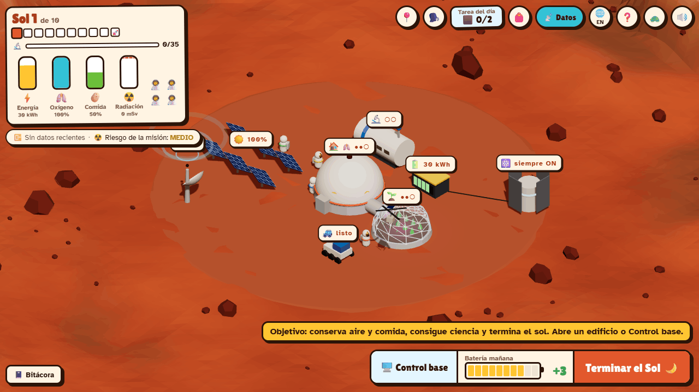
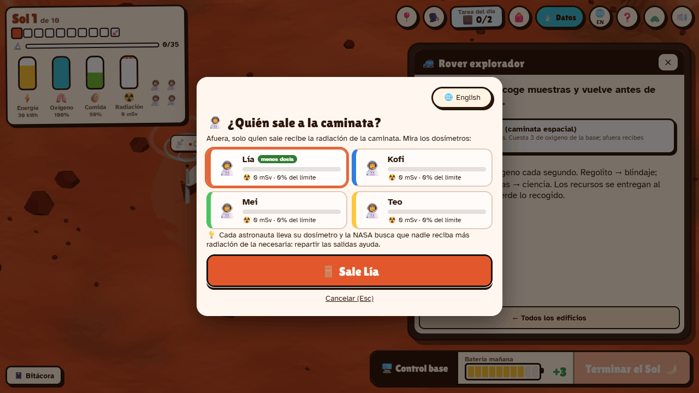
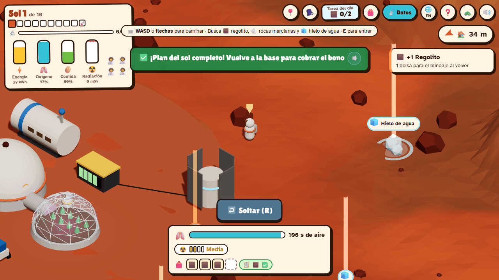
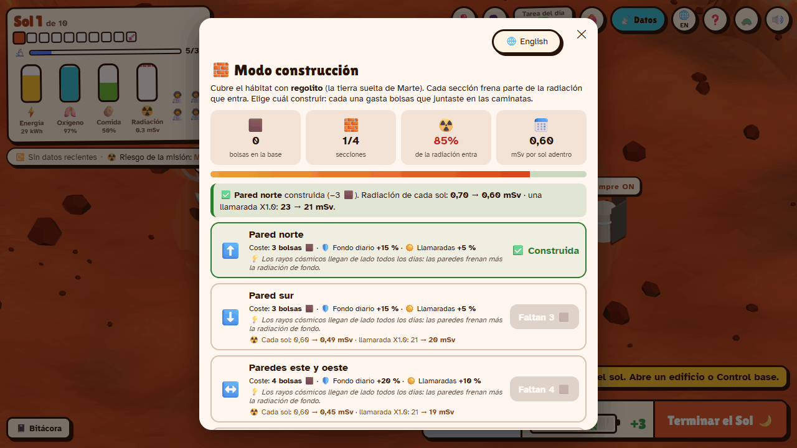
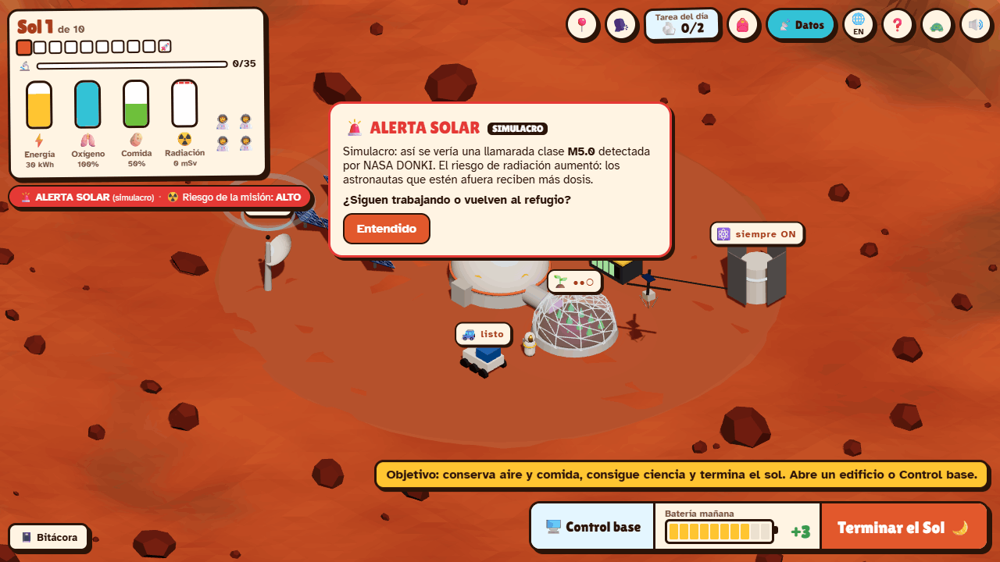
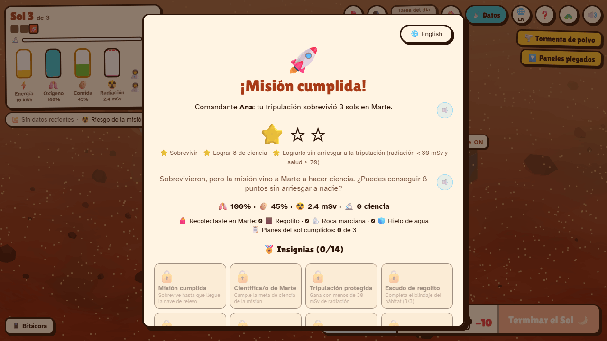

# Pitch y envío — Survival Mars

> Revisar en la página del equipo de Space Apps los campos y límites exactos del formulario de envío antes de pegar.

## Recorrido listo para presentar

Abrir **https://survival-mars.pages.dev/?demo=1&lang=en** una vez que estos cambios estén desplegados. En local usar `http://localhost:5500/?demo=1&lang=en`.

1. **Sol 1 — energía:** abrir Base control y encender el laboratorio. Mostrar el pronóstico de oxígeno, comida y ciencia. El laboratorio consume la misma energía que necesitan los otros sistemas.
2. **Sol 2 — protección y autonomía:** aparece una llamarada histórica del 3 de octubre de 2024. Pedir ayuda: la respuesta llega tarde. Elegir refugio y mostrar el costo en trabajo y cosecha.
3. **Sol 3 — tormenta:** elegir entre proteger los paneles o conservar parte de la producción solar. Mostrar la consecuencia y terminar con una pregunta del repaso.

El modo se identifica como demostración, usa datos históricos y da 30 segundos por emergencia para explicar la decisión. No requiere cambiar el estado desde la consola ni depende de DONKI. La secuencia de eventos es fija; las caminatas siguen siendo opcionales.

**Narración breve en inglés:**

“Survival Mars turns NASA data into decisions children can experience. More science uses power that life support also needs. Shelter reduces radiation exposure, but the crew gives up a day of work. Earth’s advice takes minutes to arrive, so the child must decide. We use NASA DONKI observations, Curiosity measurements and linked OSDR studies. The scenarios and doses are simplified learning rules, not a forecast for Mars. At the end, children explain three trade-offs and receive feedback.”

No afirmar mejoras de aprendizaje hasta completar la prueba de usuarios de `VALIDACION.md`.

## Capturas para el envío
Tomadas de la vista previa (`samuel.survival-mars.pages.dev`), 1280×720, en `docs/img/` (menos de 160 KB cada una).
Algunos textos pueden variar un poco respecto de la versión final.

| Archivo | Qué muestra | Úsala para |
|---|---|---|
| `img/01-base.png` | La base en NE Syrtis, tanques de recursos, ruta de la misión e indicador del Sol | Imagen principal del proyecto |
| `img/02-tripulacion.png` | Elegir quién sale a caminar, con los 4 dosímetros | Trade-off de radiación por persona |
| `img/03-caminata-mochila.png` | Caminata: recoger regolito, mochila 3/4 y panel de radiación | Exploración con costo |
| `img/04-construccion.png` | Modo construcción: pared norte construida, 0,70 → 0,60 mSv por sol | Blindaje que cambia la dosis |
| `img/05-alerta-solar.png` | Alerta solar (SIMULACRO) con NASA DONKI | Datos de la NASA en la decisión |
| `img/06-final.png` | Pantalla final: estrellas, criterios e insignias | Cierre y rejugabilidad |

## 1. Guion del video (2 minutos)

| Tiempo | En pantalla | Narración (ES) |
|---|---|---|
| 0:00–0:12 | Logo + escena 3D de la base en NE Syrtis, amaneciendo | "Es el Sol 6 en Marte. Llega una tormenta de polvo. Tienes 10 segundos: ¿retraes los paneles y pierdes energía esta noche… o te arriesgas a perderlos para siempre?" |
| 0:12–0:25 | Modal de la tormenta con la cuenta regresiva | "Eso le pasó de verdad al rover Opportunity en 2018. Así es **Survival Mars**: un entrenador de misiones para niños de 7 a 12 años." |
| 0:25–0:45 | Tocar el hábitat, botones − / +, barra de energía en rojo | "El niño es comandante de una base en la meseta NE Syrtis, uno de los sitios que la NASA estudió para Perseverance. Reparte energía entre oxígeno, comida, comunicaciones y ciencia. **Nada es gratis**: encender el laboratorio deja menos energía para el oxígeno." |
| 0:45–1:00 | Elegir quién sale (4 dosímetros) → caminata: recoger regolito con **E**, mochila 4/4, panel ☢️ "Radiación actual · Exposición · Afuera" | "Antes de salir, elige quién va: cada astronauta lleva su propio dosímetro. Afuera recoge regolito, hielo y rocas en una mochila de 4 objetos. El panel muestra la radiación de ahora y cuánto lleva acumulado. Cada segundo afuera cuesta oxígeno y dosis." |
| 1:00–1:12 | En la puerta: "📦 Depositar 4 y entrar" → tecla **B** → construir la pared norte: "0,70 → 0,60 mSv por sol" | "Con el regolito construye el blindaje, sección por sección. No es decoración: cada sección baja la radiación que entra al hábitat." |
| 1:12–1:27 | Indicador "☀️ Actividad solar" → alerta 🚨 (grabar con `?alerta=1`: aparece como SIMULACRO) | "El juego vigila el Sol con NASA DONKI durante la partida. Si aparece una llamarada, sube el riesgo: ¿siguen trabajando o vuelven al refugio? En el video mostramos un simulacro, y el juego lo dice." |
| 1:27–1:40 | Botón "Pedir ayuda": "tu mensaje tarda 12 minutos…" | "¿Pedir ayuda a la Tierra? El mensaje tarda minutos en llegar. En Marte, la tripulación decide sola." |
| 1:40–1:52 | Resumen del sol con la tarjeta de OSDR + panel "¿Qué es real?" | "Cada consecuencia muestra un estudio real de la NASA, con su fuente. Y el juego separa lo que es dato en vivo, lo guardado y lo que es regla del juego." |
| 1:52–2:00 | Pantalla final con estrellas + link | "Se juega en el navegador, sin descargas ni cuentas. **survival-mars.pages.dev**. ¿Estás listo para el asiento del comandante?" |

**Consejos de grabación:** usar la versión publicada; borrar `localStorage` para que salga el tutorial; grabar a 1080p;
para mostrar la secuencia corta, usar el modo `?demo=1` identificado en pantalla. Para la alerta solar, grabar con `?alerta=1`:
aparece a los 4 segundos como **SIMULACRO** (no presentarla como una llamarada real). Controles: WASD/flechas, E/Q recoger, R soltar, B construir, Esc cerrar.

## 2. Texto de envío (English — for judges)

**Project name:** Survival Mars — Junior Astronaut Mission Trainer

**High-level summary (≈170 words):**
Survival Mars is a free, browser-based 3D isometric game where kids aged 7–12 command a base on the NE Syrtis plateau at the edge of Isidis Planitia, Mars (a NASA Mars 2020 finalist landing site),
for 10 or 15 sols. They split a limited power budget between life support, food production, communications and science.
They choose which of four crew members goes on a spacewalk — each one carries a personal dosimeter — and walk out to collect
regolith, water ice and Martian rocks in a 4-item backpack while suit oxygen drains and radiation builds up. Back at the base,
they spend regolith to build the habitat's radiation shield section by section (north wall, south wall, east/west walls, roof);
each section really lowers the dose inside. A solar-activity indicator and an in-game check of NASA DONKI every 10 minutes
raise the risk when a new strong flare appears. Emergencies (dust storms, micrometeorites, flares) need a decision in seconds,
and Earth's advice arrives late. No choice is free. Every consequence cites its NASA source, and the game shows what is live data,
stored data or a simplified game rule.

**How it addresses the challenge:**
- All five required trade-offs: life support, radiation shielding, power budgeting, food production, communication delay.
- Radiation is a real decision, not a number: who goes outside (individual dosimeters), how long they stay, which shield section to build, and whether to shelter when DONKI shows a strong flare.
- Few core resources (energy, oxygen, food, radiation) plus crew health and a science goal.
- No "safe" choice: playing passively survives but earns 1 star; reckless science loses to radiation. Balance validated with 300 simulated games per strategy.
- Replayable: random events, real space weather and different strategies; failure explains what happened instead of punishing.
- Plain language, guided tutorial, touch joystick; runs in any modern browser with no account.

**NASA data used** (full mapping: https://github.com/SamuA123/survival-mars/blob/main/docs/DATOS_NASA.md):
- NASA DONKI solar flares (recent query via NASA Open APIs, 6-hour cache or labelled historical archive, plus an in-game check every 10 minutes): https://kauai.ccmc.gsfc.nasa.gov/DONKI/ · API: https://api.nasa.gov
- Curiosity RAD, Mars surface radiation (Hassler et al. 2014, *Science* 343): https://ntrs.nasa.gov/citations/20180007641
- NASA OSDR RadLab (ISS dosimetry): https://visualization.osdr.nasa.gov/radlab/
- NASA OSDR, 13 studies (URL pattern `https://osdr.nasa.gov/bio/repo/data/studies/OSD-<number>`): [OSD-87](https://osdr.nasa.gov/bio/repo/data/studies/OSD-87) · [OSD-146](https://osdr.nasa.gov/bio/repo/data/studies/OSD-146) · [OSD-177](https://osdr.nasa.gov/bio/repo/data/studies/OSD-177) · [OSD-268](https://osdr.nasa.gov/bio/repo/data/studies/OSD-268) · [OSD-334](https://osdr.nasa.gov/bio/repo/data/studies/OSD-334) · [OSD-342](https://osdr.nasa.gov/bio/repo/data/studies/OSD-342) · [OSD-343](https://osdr.nasa.gov/bio/repo/data/studies/OSD-343) · [OSD-360](https://osdr.nasa.gov/bio/repo/data/studies/OSD-360) · [OSD-566](https://osdr.nasa.gov/bio/repo/data/studies/OSD-566) · [OSD-615](https://osdr.nasa.gov/bio/repo/data/studies/OSD-615) · [OSD-678](https://osdr.nasa.gov/bio/repo/data/studies/OSD-678) · [OSD-766](https://osdr.nasa.gov/bio/repo/data/studies/OSD-766) · [OSD-772](https://osdr.nasa.gov/bio/repo/data/studies/OSD-772)
- NASA Mars Trek (NE Syrtis base site): https://trek.nasa.gov/mars/
- Mars 2020 landing-site shortlist (NE Syrtis): https://astrobiology.nasa.gov/news/scientists-shortlist-three-landing-sites-for-mars-2020/
- MOXIE oxygen production (Perseverance): https://www.nasa.gov/missions/mars-2020-perseverance/perseverance-rover/nasas-oxygen-generating-experiment-moxie-completes-mars-mission/
- Opportunity and the 2018 dust storm: https://science.nasa.gov/mission/mer-opportunity/
- MRO new-impact survey (meteorites): https://www.jpl.nasa.gov/news/nasa-probe-counts-space-rock-impacts-on-mars/
- Mars solar conjunction: https://www.nasa.gov/solar-system/whats-mars-solar-conjunction-and-why-does-it-matter/
- NASA HRP, communication delay (distance from Earth): https://www.nasa.gov/hrp/hazard-distance-from-earth/
- NASA-STD-3001 radiation limits (OCHMO technical brief): https://www.nasa.gov/wp-content/uploads/2023/03/radiation-protection-technical-brief-ochmo.pdf
- Regolith shielding for a Mars habitat (Simonsen et al., NASA NTRS): https://ntrs.nasa.gov/citations/19900062325

> Al pegar en el formulario, revisar que los links largos no se corten (el de la conjunción solar debe terminar en
> `whats-mars-solar-conjunction-and-why-does-it-matter/`). Si el campo tiene límite de caracteres, dejar el link a
> `DATOS_NASA.md` y los principales (DONKI, Curiosity RAD, OSDR, Mars Trek).

**Space agency partner resources:** Canadian Space Agency — food production in space (greenhouse mechanic).

**Tools:** JavaScript, Three.js (WebGL), HTML/CSS, Cloudflare Pages, GitHub.

**Use of AI:** We used AI coding assistants (Claude Code and Codex) to help write code, check NASA sources and draft documentation.
The team designed the game, reviewed and tested the results, and verified the data against the cited NASA sources.

## 2b. Detalles del proyecto (campo del formulario)

Responde las preguntas del formulario: qué hace, beneficios, impacto, herramientas, creatividad y factores considerados.
Listo para pegar. Hay versión en español y en inglés: usar la del idioma del formulario.

### Español

**¿Qué hace y cómo funciona?**
Survival Mars es un juego 3D gratuito que se juega en el navegador, sin instalar nada ni crear cuentas. Niños de 7 a 12 años dirigen una base en la meseta NE Syrtis, en Marte (uno de los tres sitios finalistas de aterrizaje de Mars 2020), durante 10 o 15 sols. Cada sol reparten una energía limitada entre soporte vital, invernadero, comunicaciones y laboratorio. Eligen cuál de los cuatro astronautas sale a una caminata (cada uno lleva su propio dosímetro), recogen regolito, hielo de agua y rocas en una mochila de 4 espacios mientras se gasta el oxígeno del traje, y con el regolito construyen el blindaje del hábitat por secciones: el techo protege más de las llamaradas y las paredes, de la radiación diaria de fondo. Surgen emergencias (tormentas de polvo, llamaradas solares, micrometeoritos) que hay que resolver en segundos, y la ayuda de la Tierra llega tarde por el retraso de las comunicaciones. Ninguna decisión es gratis.

**¿Qué beneficios ofrece?**
Convierte datos reales de la NASA en decisiones que un niño puede vivir: entiende qué es un sol, un milisievert o una conjunción solar justo cuando lo necesita. Cada consecuencia muestra su fuente, y el juego separa lo que es dato en vivo, dato guardado y regla simplificada. Funciona en computadoras escolares lentas (modo de gráficos ligeros) y en celulares, en español e inglés, con narrador por voz, dos dificultades (Cadete y Comandante), tutorial y una misión guiada de construcción. La partida se guarda sola y hay una guía para docentes.

**¿Cuál es el impacto previsto?**
Que estudiantes de primaria y secundaria aprendan a razonar con compromisos reales de una misión (energía contra ciencia, explorar contra protegerse de la radiación) y lleguen a explicarlos con sus palabras, no solo a memorizarlos. Al ser gratuito y abierto, cualquier escuela puede usarlo en clase sin costo ni registro, y docentes de otros países pueden adaptarlo.

**¿Qué herramientas usamos?**
JavaScript (módulos nativos, sin compilación), Three.js (WebGL) para el mundo 3D, HTML y CSS, NASA Open APIs (DONKI), pruebas automáticas con Node.js (más de 30 pruebas y miles de partidas simuladas para equilibrar el juego), GitHub y Cloudflare Pages para publicar. El video se generó con Python, Playwright, una voz neuronal y ffmpeg. Usamos asistentes de programación con IA (Claude Code y Codex); el equipo diseñó el juego, revisó y probó todo, y verificó los datos con las fuentes de la NASA.

**¿En qué sentido es creativo?**
La radiación no es un número en pantalla: es una decisión. Elegir quién sale (cada astronauta acumula su propia dosis), cuánto tiempo se queda afuera y qué sección del blindaje construir primero. Cuando NASA DONKI detecta una llamarada fuerte, el juego reacciona incluso en medio de una caminata. Todo ocurre en una base 3D isométrica, con astronautas que se controlan con teclado o con joystick táctil.

**¿Qué factores tuvo en cuenta el equipo?**
Lenguaje simple para niños de 7 años y explicaciones en el momento; accesibilidad (voz, dos idiomas, celular, computadoras lentas); honestidad científica (nunca presentar datos guardados como "en vivo" y marcar las reglas simplificadas); privacidad (sin cuentas: la partida se guarda solo en el navegador); que fallar enseñe en vez de castigar; y un equilibrio sin opción "segura": jugar pasivo sobrevive con 1 estrella y arriesgarse sin pensar termina mal.

### English

**What it does and how it works:** Survival Mars is a free 3D browser game (no install, no account) where kids aged 7–12 command a base on the NE Syrtis plateau, Mars (a Mars 2020 finalist landing site), for 10 or 15 sols. Each sol they split limited power between life support, greenhouse, communications and the lab. They choose which of four astronauts goes on a spacewalk (each wears a personal dosimeter), collect regolith, water ice and rocks in a 4-slot backpack while suit oxygen drains, and spend regolith to build the habitat shield section by section: the roof blocks more flare radiation, the walls more daily background radiation. Emergencies (dust storms, solar flares, micrometeorites) need a decision in seconds, and Earth's advice arrives late. No choice is free.

**Benefits:** It turns real NASA data into decisions a child can feel, explaining terms like sol, millisievert or solar conjunction right when they matter. Every consequence cites its source, and the game separates live data, stored data and simplified game rules. It runs on slow school computers (light graphics mode) and on phones, in Spanish and English, with voice narration, two difficulty levels, a tutorial and a guided building mission. Progress saves automatically, and there is a teacher guide.

**Expected impact:** Students learn to reason about real mission trade-offs (power vs. science, exploring vs. radiation safety) and explain them in their own words. It is free and open, so any school can use it with no cost or sign-up, and teachers elsewhere can adapt it.

**Tools:** JavaScript (native modules, no build step), Three.js (WebGL), HTML/CSS, NASA Open APIs (DONKI), automated tests in Node.js (30+ tests and thousands of simulated games for balance), GitHub and Cloudflare Pages. The video was generated with Python, Playwright, a neural voice and ffmpeg. We used AI coding assistants (Claude Code and Codex); the team designed the game, reviewed and tested everything, and verified the data against NASA sources.

**Creativity:** Radiation is a decision, not a number: who goes outside (each astronaut accumulates their own dose), how long they stay, and which shield section to build first. When NASA DONKI reports a strong flare, the game reacts even in the middle of a spacewalk.

**Factors considered:** plain language for 7-year-olds with just-in-time explanations; accessibility (voice, two languages, phones, slow computers); scientific honesty (stored data is never shown as live, and simplified rules are labelled); privacy (no accounts, progress stays in the browser); failure that teaches instead of punishing; and balance with no "safe" option.

## 3. Resumen en español (para presentar)
Survival Mars es un juego 3D gratuito en el navegador donde niños de 7 a 12 años dirigen una base en la meseta NE Syrtis (Isidis Planitia)
durante 10 o 15 sols. Reparten energía entre oxígeno, comida, comunicaciones y ciencia. Eligen cuál de los 4 astronautas sale a caminar
—cada uno con su dosímetro—, recogen regolito, hielo de agua y rocas marcianas en una mochila de 4 objetos mientras se gasta el oxígeno
del traje, y con el regolito construyen el blindaje del hábitat sección por sección (cada sección baja de verdad la radiación que entra).
Un indicador del Sol y una consulta a NASA DONKI cada 10 minutos suben el riesgo si aparece una llamarada fuerte: ¿seguir trabajando
o volver al refugio? Cada consecuencia cita su fuente de la NASA (Curiosity, OSDR, MOXIE, Opportunity) y el juego separa lo que es
dato en vivo, lo guardado y lo que es regla simplificada. Ninguna decisión es gratis.
